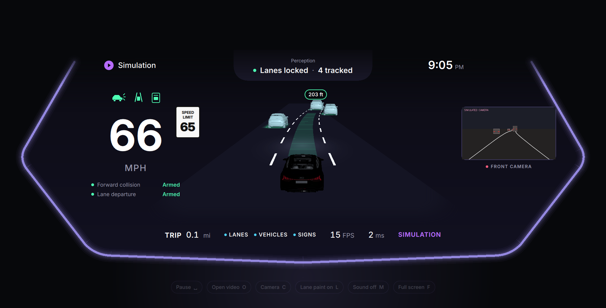
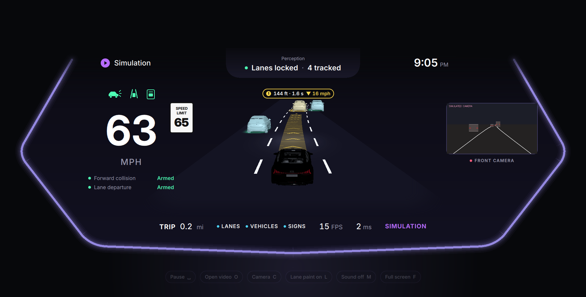
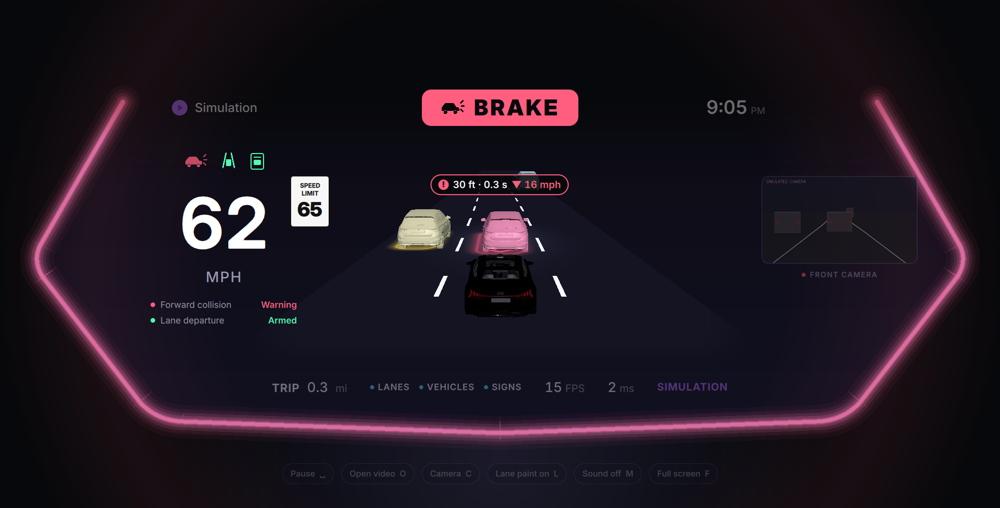
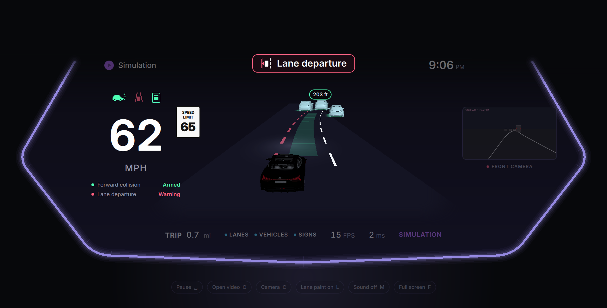
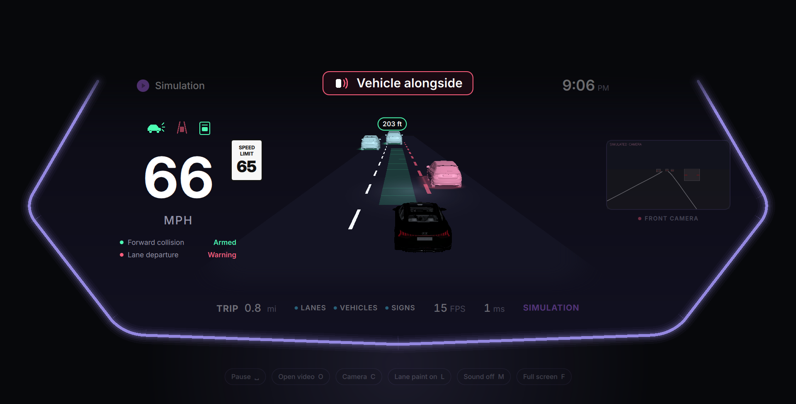
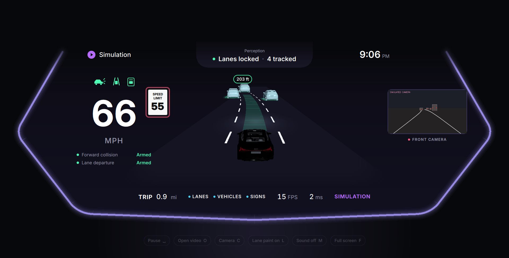

<p align="center">
  
</p>

<p align="center">
  <a href="https://opensource.org/licenses/MIT"></a>
  
  
  
</p>

# ADAS Instrument Cluster — 3D Lane Detection + CIPO on NVIDIA Jetson

A real-time driver-assistance display for **NVIDIA Jetson Orin Nano** (and any Jetson Orin). TensorRT perception — 3D lane detection, YOLO + ByteTrack vehicles, closest-in-path object (CIPO) ranging, traffic-sign speed limits — drives a GPU-rendered **instrument cluster**: a live 3D scene of the road with every tracked vehicle drawn as a 3D model and coloured **green / yellow / red** by threat, plus speed, posted limit, lane-departure and forward-collision warnings, alert sounds and a front-camera view.

This software is **SAE Level 0** driver assistance: it informs and warns. It does **not** steer, brake or accelerate. The driver remains fully responsible at all times. It is for research, demonstration and development, not a certified production ADAS.

<table>
  <tr>
    <td width="50%"><br/><b>Cruise</b> — lead vehicle at a safe gap (green band, distance tag)</td>
    <td width="50%"><br/><b>Closing fast</b> — yellow band, time gap and closing speed, flowing chevrons</td>
  </tr>
  <tr>
    <td><br/><b>Imminent collision</b> — solid BRAKE banner, red vehicle and band, red vignette, urgent tone</td>
    <td><br/><b>Lane departure</b> — departing line turns red, ego drifts toward it, directional tone</td>
  </tr>
  <tr>
    <td><br/><b>Drifting toward an occupied lane</b> — that vehicle turns red</td>
    <td><br/><b>Over the posted limit</b> — limit plate outline yellow, then red with one tone</td>
  </tr>
</table>

<sub>Screenshots are rendered by the app itself from its built-in simulation (`--screenshots`).</sub>

---

## Quick start (Jetson Orin Nano, JetPack 6)

```bash
# 1) One-step setup: system packages, venv, Python deps, TensorRT engines from ONNX
chmod +x setup.sh
./setup.sh                      # add --system-opencv if you will use a CSI camera

# 2) See the cluster immediately (scripted perception, no engines needed)
./scripts/run_cluster.sh --sim

# 3) Run perception on your own dashcam footage
./scripts/run_cluster.sh --video /path/to/drive.mp4

# 4) Live camera
./scripts/run_cluster.sh --camera 0                 # USB camera (/dev/video0)
./scripts/run_cluster.sh --camera csi               # CSI camera (IMX219 / IMX477 …)

# Kiosk: full screen, km/h, live speed from an OBD-II adapter, max clocks
ADAS_MAX_PERF=1 ./scripts/run_cluster.sh --camera 0 --speed obd --fullscreen --units kmh
```

> **Model weights:** the `models/*.onnx` files are Git LFS objects. In a git clone `setup.sh` fetches them (`git lfs pull`); if you copied the project as a zip, each file is a ~130-byte pointer — put the real ONNX files in `models/` before running `setup.sh`, or the cluster starts with every perception model shown as off.

> **Which Jetson?** This stack needs JetPack 6 (Python 3.10, CUDA 12.6, TensorRT 10): Jetson **Orin Nano / Orin NX / AGX Orin**. The original 2019 Jetson Nano is limited to JetPack 4 (Python 3.6), which cannot run PySide6, Qt Quick 3D or Ultralytics.

> **Demo clip:** `data/demo/clip_8s.mp4` is a screen recording of the earlier UI, not raw camera footage — use it to check that video playback works, then point `--video` at real dashcam footage for perception.

### Inputs

| Flag | Source |
| :--- | :--- |
| `--video <file>` | Any video OpenCV can read (default: `data/demo/clip_8s.mp4`) |
| `--camera 0` or `--camera /dev/video0` | USB / V4L2 camera, 1280×720 MJPG |
| `--camera csi` / `--camera csi:1` | Jetson CSI camera through `nvarguscamerasrc` (needs `./setup.sh --system-opencv`) |
| `--camera "gst:<pipeline>"` | Any GStreamer pipeline ending in `appsink` |
| `--sim` | Scripted 60 s scenario through every alert; LDW/FCW decisions still come from the real alert logic |

### Ego speed (`--speed`)

LDW arms above 25 mph and FCW above 15 mph, so the pipeline needs the vehicle's speed.

| Value | Source |
| :--- | :--- |
| `auto` (default) | Per-frame speed JSON next to the video (Garmin HUD OCR), else unknown |
| `fixed:65mph`, `fixed:100kmh` | Constant speed, for bench demos |
| `obd` / `obd:/dev/ttyUSB0` | Live OBD-II speed via an ELM327 adapter (`pip install obd`) |
| `none` | Unknown: speed shows `--`, LDW stays in standby, FCW still runs |

### Cluster controls

| Key | Action |
| :--- | :--- |
| `Space` | Pause / play |
| `C` | Swap the 3D scene and the full front-camera view (or tap the camera tile) |
| `L` | Lane paint on the camera view on / off |
| `M` | Alert sounds on / off |
| `O` | Open another video |
| `F` / `Esc` | Full screen / leave full screen |
| `Q` | Quit |

The same actions sit in a dim control strip under the bezel; it brightens on hover.

---

## What the cluster shows

Layout follows the ADAS Cluster UI/UX spec: dark field inside a violet bezel; speed, telltales and function status on the left; the live 3D scene in the centre; the front camera on the right; perception status on top; trip, models, FPS and latency at the bottom. Colour is spent only on state — **green / yellow / red** for threat, **cyan** for information, **orange** for degraded.

| Situation | Threat | In the 3D scene | Banner | Sound |
| :--- | :--- | :--- | :--- | :--- |
| Lead vehicle, time gap ≥ 2.0 s, TTC > 4 s | Green | Green band to the lead, distance tag | — | — |
| Time gap 1–2 s, TTC 2.6–4 s, or closing > 20 km/h | Yellow | Yellow tint and halo, tag adds time gap and closing speed, chevrons flow toward the lead | — | One soft tone when closing fast |
| Time gap < 1 s, TTC ≤ 2.6 s, or FCW | Red | Red tint, pulsing halo, red band, chevrons pointing back at you | "Collision warning" | Repeating tone (4/s) |
| FCW+ (TTC < 1.4 s or < 8 m) | Red | As above | Solid **BRAKE** + red vignette | Urgent tone (6/s) |
| LDW: close to a line | Yellow | That lane line yellow, wider | — | — |
| LDW: departing | Red | Line red and pulsing, ego drifts toward it | "Lane departure" | Two beeps on that side |
| Departing toward an occupied adjacent lane | Red | That vehicle red | "Vehicle alongside" | Two beeps on that side |
| Adjacent vehicle within 12 m or edging in | Yellow | Yellow tint and halo | — | — |
| Over the posted limit | Yellow → Red | Limit-plate outline (> 2, then ≥ 10 over) | — | One tone per limit |

Rules that hold everywhere: one banner and one sound at a time (highest priority wins); escalation is immediate, de-escalation waits 0.5 s and red holds at least 1 s, so colours never flicker; red elements pulse at 2 Hz; during any red alert the non-driving content (source, clock, camera, trip) dims to 40 %. All thresholds live in [`src/adas/threat.py`](src/adas/threat.py).

---

## Architecture

```text
 video / USB / CSI ─▶ InferenceWorker (QThread)                       SimulationWorker (--sim)
                       ├─ Anchor3DLane TensorRT  → RoadStateEstimator          │ same signal
                       ├─ YOLOv8 + ByteTrack     → CIPOTracker (ground range)  │
                       ├─ Traffic signs + LPRNet → SpeedLimitTracker           │
                       ├─ LDW / FCW (AdasWarningTracker)                       │
                       └─ speed source (JSON / fixed / OBD-II)                 │
                                 │ frame_processed                             │
                                 ▼                                             ▼
                       ClusterController (src/ui/cluster_app.py)
                        ├─ ThreatAssessor   green/yellow/red per object, lane states, banner, sound
                        ├─ BevSceneDriver   3D scene: GLB vehicles, lanes, gap band, chevrons, tag
                        ├─ CameraProvider   annotated front camera → image://camera
                        ├─ AlertAudio       synthesized earcons (QtMultimedia)
                        └─ hud map ───────▶ Cluster.qml (Qt Quick + Qt Quick 3D, OpenGL RHI)
```

| Path | Role |
| :--- | :--- |
| `src/ui/qml/Cluster.qml` | The cluster (authored at 1920 × 976, scaled to any window) |
| `src/ui/qml/BevScene.qml` | 3D driving scene (also used by the classic UI) |
| `src/ui/cluster_app.py` | Controller, camera provider, earcons, SoC temperature |
| `src/adas/threat.py` | Threat levels, hysteresis, alert arbitration (unit-tested) |
| `src/ui/bev_quick3d.py` | Perception → 3D scene payloads (lane frame, traffic, band, chevrons) |
| `src/ui/worker.py` | TensorRT pipeline thread; video, USB and CSI input |
| `src/ui/sim_source.py` | Scripted perception for demos and tests |
| `src/utils/speed_source.py` | Speed from JSON log, fixed value or OBD-II |
| `scripts/run_cluster.sh` | Launcher (venv, OpenGL RHI, optional max clocks) |
| `deploy/adas-cluster.service` | systemd user unit for kiosk autostart |

The previous widget cockpit is still available with `--ui classic`.

---

## Testing

```bash
source venv/bin/activate
python tests/test_threat.py                                    # threat logic unit tests
python scripts/run_pyside6_app.py --sim --screenshots out/     # render every alert state to PNG
python scripts/run_pyside6_app.py --test-mode                  # headless start-up smoke test
```

---

## Limits

* Front camera only: there is no blind-spot, rear or cross-traffic sensing. "Vehicle alongside" covers vehicles the front camera can see in the adjacent lane ahead.
* No CAN connection: gear, turn signals and ACC are not shown. Speed comes from the selected speed source.
* Range is monocular ground-plane estimation; accuracy depends on calibration (see MANUAL.md).

---

## If something doesn't work

Open **[MANUAL.md](MANUAL.md)** and start at **Help**.

| What failed | Read |
| :--- | :--- |
| `./setup.sh` errors, missing packages, or TensorRT / import failures | [Help → Setup](MANUAL.md#setup-fails) |
| Cluster opens but the 3D scene is blank, or the window will not open | [Help → Cluster display](MANUAL.md#cluster-display-problems) |
| Camera will not open | [Help → Live camera](MANUAL.md#live-camera) |
| App runs but lanes, vehicles, or signs are missing (no `.engine`) | [Help → Engines](MANUAL.md#engines-missing-or-wont-build) |
| Lanes, corridor width, or the 3D scene look wrong | [Help → Camera and BEV](MANUAL.md#lanes-or-bev-look-wrong) |

---

## Acknowledgements

- **Model:** [Anchor3DLane](https://github.com/tusen-ai/anchor3dlane)
- **Dataset:** [OpenLane](https://github.com/OpenDriveLab/OpenLane)
- **Typeface:** [Inter](https://rsms.me/inter/) (SIL Open Font License, `src/ui/qml/fonts/OFL-Inter.txt`)

## License

MIT — see [LICENSE](LICENSE).
# ADAS_v0
